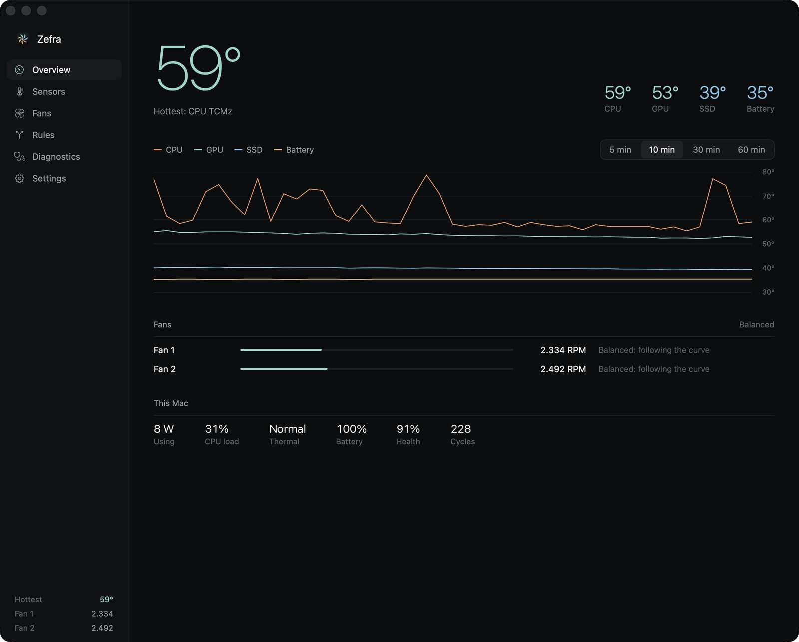
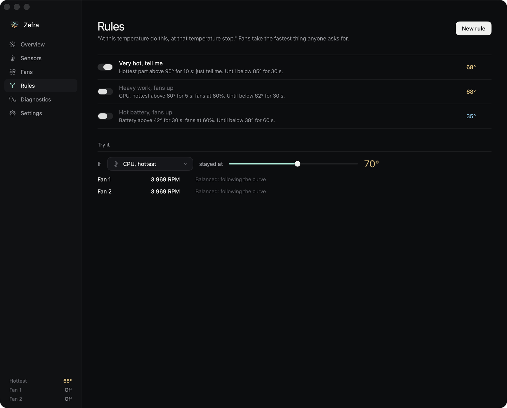
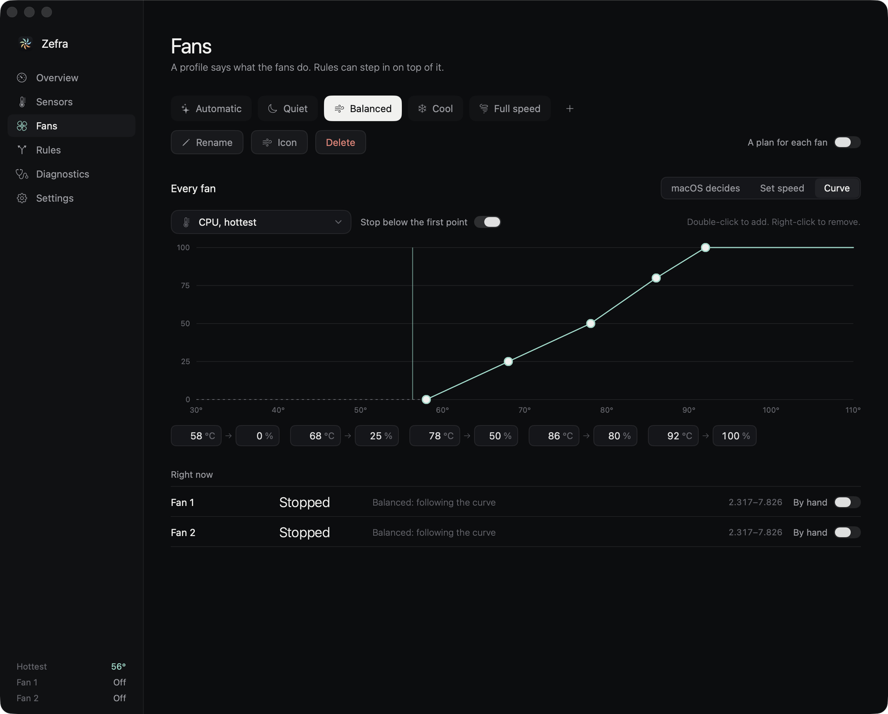
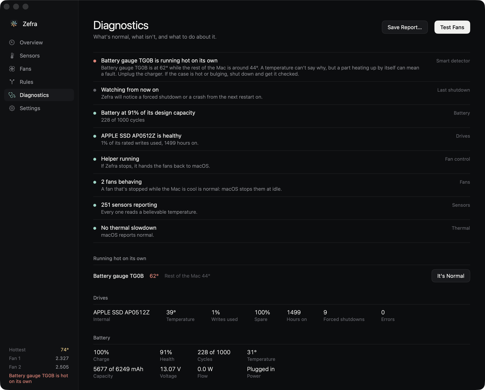
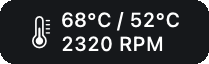
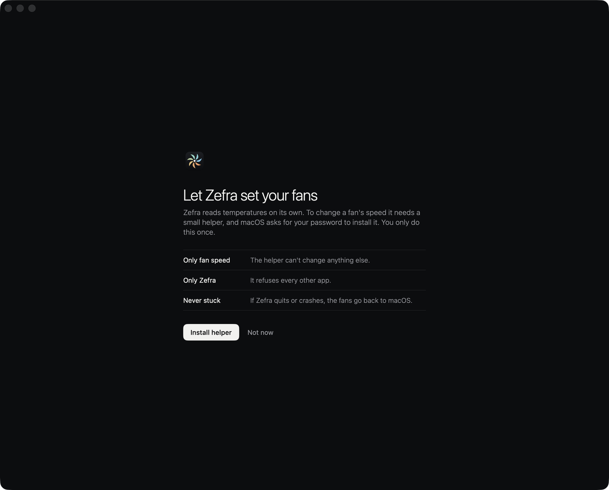

<p align="center">
  
</p>

<h1 align="center">Zefra</h1>

<p align="center">
  Know how hot your Mac runs, and decide what the fans do about it.
</p>

<p align="center">
  
  
  
</p>

<p align="center">
  
</p>

> [!NOTE]
> **Zefra is new.** It's built and tested on one MacBook Pro (M4 Pro). Sensors and diagnostics run on real hardware; fan control has been tested against pretend fans, and hasn't yet been confirmed end to end on a real one.

<p align="center">
  <a href="https://github.com/Naqara-Dev/Zefra/releases/latest"><b>Download the latest release</b></a>
</p>

The download isn't notarized yet, so macOS blocks it the first time. Open **System Settings › Privacy & Security** and choose **Open Anyway**. After that it updates itself.

## At this temperature, do this

Most fan apps give you a slider. Zefra gives you rules: *at this temperature do this, at that temperature stop*, each with a hold time so a passing spike does nothing.

Watch the hottest part, the hottest or average CPU, a group, or a single sensor. Set a fan speed, switch profile, or just get told. Limit a rule to plugged in, on battery, or a time of day. **Try it** shows what the fans would do at any temperature, before it happens.

<p align="center">
  
</p>

## Curves you can drag

Automatic, Quiet, Balanced, Cool and Full speed to start with, all editable, and as many of your own as you like. A profile leaves the fans to macOS, holds a speed, or follows a curve on any sensor, for every fan or one plan per fan. Below the first point a fan can go back to macOS, which can stop it.

<p align="center">
  
</p>

## A part running hot on its own

The smart detector warns when a battery, charger, drive or board sensor is out of line while the rest of the Mac isn't. It checks three things:

| | |
|---|---|
| **The sensors beside it** | A battery's sensors should agree. One far above the others stands out straight away. |
| **Fixed limits** | Hotter than that kind of part should get, with the rest of the Mac well below it. |
| **What's usual here** | It learns what each sensor reads on this Mac, for the same charge state and load, and notices when that changes. |

It runs entirely on your Mac. It can spot the heat, not the cause: a temperature can't tell a short from something sitting on the charger, so it tells you what it saw and what to check.

<p align="center">
  
  <br>
  <sub>The battery sensor here was set to 62° for the screenshot.</sub>
</p>

## Everything else

| | |
|---|---|
| **Sensors** | Every temperature the Mac reports, grouped, with lows, highs and history. Rename or hide any of them. NVMe drives, external ones included, are read through SMART. |
| **Diagnostics** | Sensors, fans, drives, battery condition and thermal pressure, whether the last shutdown was clean, a fan test, and a report to save. |
| **Alerts** | Notifications with the sound you pick, and email through your own SMTP server, for rules, forced shutdowns, crashes, batteries and drives. |
| **Menu bar** | Choose what it shows and how it's laid out. The panel under it has fan controls, Max, and profiles. |
| **Keys** | Global keys to show Zefra, send the fans to Max, or step through profiles. |
| **Logs** | CSV with your choice of folder and schedule, alerts marked, and history to export. |
| **Updates** | In place, checked against a signing key. |

<p align="center">
  
</p>

### From the command line

```sh
zefra status --json     # temperatures and fans, for scripts
zefra fans set 60       # every fan at 60%
zefra fans auto         # back to macOS
zefra profile Quiet
zefra diagnostics       # exits 2 if something's wrong
zefra help              # the rest
```

The binary is inside the app, at `Zefra.app/Contents/MacOS/Zefra`. Fan commands take effect through the running app.

## Safety

Reading temperatures needs no special rights. Setting a fan speed needs root, so the first time you open Zefra it offers to install a small helper, and macOS asks for your password once. You can say not now and keep everything else.

- The helper sets fan speed and nothing else, within the range each fan reports.
- It only takes calls from an app signed with its own certificate, and refuses to start unsigned.
- If the app quits, crashes or hangs, it hands the fans back to macOS.
- At the failsafe temperature (98° by default, never above 105°) every fan goes back to macOS, whatever a profile or rule says.
- Rules only ever add cooling: a fan takes the fastest thing anyone asks for. "Off" means back to macOS, and Zefra never forces a fan to stop while the Mac is hot.

<p align="center">
  
</p>

## What it can't do

- **USB and SATA drives.** macOS offers no way to read SMART from most USB bridges, or from SATA without a driver.
- **See a forced shutdown as it happens.** It's noticed through the internal drive's own count, at the next launch, and only if the drive counted it.
- **Name every sensor.** Apple publishes no names. Zefra uses the community's where they apply and the sensor reads a believable temperature, and otherwise names the family. The raw key always stays beside the name, and you can rename any of them.
- **Live in the App Store.** It reads the SMC and macOS's private sensor list, and fan control needs root.

## Build

To build it yourself, you need Xcode 16 or later, and a code signing certificate, because the helper only takes calls from an app signed like itself. An Apple Development certificate will do.

```sh
./scripts/test.sh       # the logic, no hardware touched
./scripts/build.sh      # build/Build/Products/Debug/Zefra.app
./scripts/e2e.sh        # the app, command line, logs and email, with pretend fans
./scripts/release.sh    # dist/Zefra-X.dmg, dist/appcast.xml, Casks/zefra.rb
```

Debug builds take `-ZefraFakeFans YES`, `-ZefraFakeTemp 85`, `-ZefraFakeSensorFile path`, `-ZefraPage rules` and `-ZefraHome path`, to try everything without root, and `ZEFRA_HOME` for the command line.

## Credits

Sensor names come from [Stats](https://github.com/exelban/stats). Updates use [Sparkle](https://github.com/sparkle-project/Sparkle). See [THIRD_PARTY_NOTICES.md](THIRD_PARTY_NOTICES.md).
